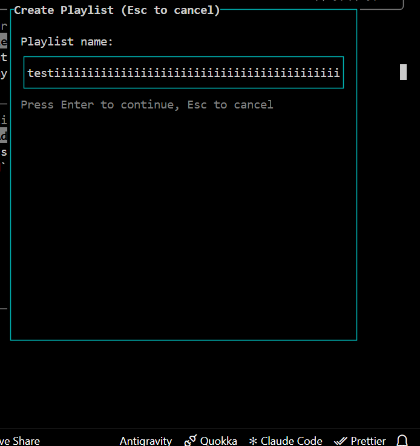
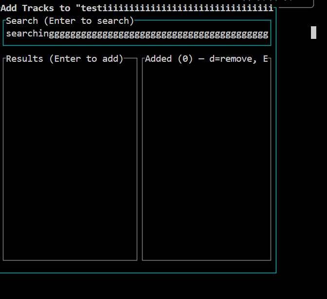

# Contribution: Create Playlist: a long name runs past the input box and the cursor leaves it (829)

Path: `beat-2-contribution/contribution-story.md`

This file is Assignment 5, and it is graded at the path above; a copy kept anywhere else in
the repository is not read. **Keep every section header below under its exact name** — the
format criteria grade exactly that. Your course repo link is the whole submission: no tool
files and no evidence uploads are part of Assignment 5.

**Contribution Number:** [1]
**Student:** [Isaiah Linares]
**GitHub Username:** [IDLinares]
**Issue:** [GitHub issue link](https://github.com/LargeModGames/spotatui/issues/829)
**Pull Request:** [Github PR link](https://github.com/LargeModGames/spotatui/pull/964)

One repository, built across units 5 to 8, telling the whole story of your real
contribution. Fill it as you work, not at the end — the sections below ask for evidence that
is far easier to write down as it happens than to reconstruct in the last weekend.

Contribution Number stays `[1]` unless you make more than one contribution this term; it
just numbers them.

---

## Toolkit

Every story section below, from Why I Chose This Issue through Pull
Request, ends with a Toolkit block: which tool did that phase's work
and how you used it, what it produced, what difficulties or
shortcomings it presented, and what you changed or would change
because of them. Together the blocks are the thread the rubric's
Toolkit points read, and they are the raw material for your unit-9
portfolio, so keep them current as you work rather than
reconstructing them later.

A Toolkit block looks like this (copy it into each story section and
fill it there):

```text
**Toolkit**

- Tool: [which tool did this phase's work, and how you used it]
- What it produced: [described in a sentence or a short excerpt]
- Difficulties: [what fought you or fell short, or "none met"]
- What changed: [the patch, revision, or workaround, what you would
  update, or "nothing"]
```

This section also keeps one short dated entry per week of tool work,
starting below: what you built or changed that week, what broke, and
what you changed because of it. The blocks tell the story where it
happened; these entries are the toolkit's own timeline.

All four entries are graded. Keep every heading below, and fill each
one in the week it belongs to.

**Unit 5: `issue-scout` with an updated an updated `search-strategy`**

For unit 5, the tool I built is `issue-scout` based off of `issue-select`. I used the same fit profile from `issue-select` to guide my search for issues and added `search-strategy.md` to the skill set. This gave me multiple queries to run against the issues along with ranking filters to narrow down the results. The results of running `issue-select` gave me results that fit my profile, so the skill was working as expected, but finding an issue from the availble issues manually still took some time.

**Unit 6: `voice-guard` with an updated `scope-feasible` field and a new repo-memory file**

For unit 6, the tool I built is the `voice-guard` with the new `scope-feasible` field so it isn't so strict for the open source repo. I also updated the repo-memory file with all the relevant information for the issue I was working on in the spotatui repo. Nothing broke as my `voice-guard` returned no conflicts with my established rules for my claim comment and repro-draft and my Claude agent was following my repo-memory file properly for implementation.

**Unit 7: `ship-gate` hook with my `ship-manifest` file for my repo**

For unit 7, the tool I built was `ship-gate` with an updated `ship-manifest.md` with three different checks for formatting, linting, and all tests in the repo. On the first run, my PR was rejected because of a fail in my rubric for the `silent-drift` check. My diff had a line change in `CHANGELOG.md` that was not specified in my plan. I needed to update my plan as any changes that can affect the terminal ui in the repo should be added to the `CHANGELOG.md`. I just forgot to add that in my plan. It passed on the second run.

**Unit 8: `pr-monitor` headless with the completed `playbook.md`**

[2-4 sentences: the PR-monitor and your playbook. What it read, what it
drafted, what you did with the draft.]

For unit 8, the tool I built was `pr-monitor` with a playbook with rules related to my repo, such as a staleness of a week since this maintainer has been very active in this repo. By the time I ran `pr-monitor` my PR was merged by the maintainer so it read a completed PR and drafted a simple thank you note to the maintainer that I posted as a comment under my PR.

---

## Why I Chose This Issue

I searched through the issue tracker website using filters that matched my fit profile. For language, I preferred JavaScript, TypeSCript, and Python. For, tags I had good first issue, bugs, and documentation. From there I scrolled and went through a couple pages and would look through the repos for different issues to see what each repo had available until I found two issues that I ran through my `issue-scout` tool. Both issues received an accept verdict through issue scout as both repos had active maintainers for issues with a small bouded fix scope that were unclaimed. I decided on the issue in the spotatui repo even though it was for the backend in Rust as it would give me an opportunity to start exploring a new language with AI in a very contained environment. The issue was also very thoroughly written out and explained which made the barrier to entry even easier for working with a new language and implementing a fix. My tool did not fall short as it led me to find a doable issue on the first run that I was capable of doing even if it wasn't directly with one of my preferred languages.

**Claim Comment**: [Claim Comment](https://github.com/LargeModGames/spotatui/issues/829#issuecomment-6406181325)

**Toolkit**

- Tool: `issue-scout` (your scout: your search strategy, your rubric),
  and how you used it
- What it produced: The `issue-scout` test on all of GitHub found 5 issues matching my fit profile that were good first issues, especially the first one that aligned with my node, express, and typescript knowledge. Running it again for 2 issues I selected from the class selection site, they also both passed the `issue-scout` and I chose the one that sounded more interesting to me.
- Difficulties: None met
- What changed: Nothing

---

## Understanding the Issue

**Problem Description**

The issue describes a bug in any text input fields in the Create Playlist popup (name and add tracks search) where the terminal cursor keeps moving to the right outside of the popup and beyond while the text gets cut off. These input fields should match the behavior of the main search bar and scroll sideways so the cursor always stays within the bounds of the input field.

**Expected Behavior**

The Create Playlist name and add tracks search input fields should match the behavior of the main search bar and scroll sideways so theterminal cursor always stays within the bounds of the input field.

**Current Behavior**

When typing something too long in the Create Playlist name and add tracks search input fields, the terminal cursor continues to the right outside the bounds of the input field with the text getting clipped at the right border.

**Affected Components**

This bug affects both input fields involved in Creating a playlist. They can both be found in `src/tui/ui/create_playlist.rs`.

**Toolkit**

- Tool: `repro-check` - I used it to validate my reproduction process to ensure I properly understood the issue.
- What it produced: It produced a full pass report with an accept verdict for my claim comment and reproduction report following my rubric against the issue I selected.
- Difficulties: None met
- What changed: No changes

---

## Reproduction Process

**Environment Setup**

[What a stranger would need to stand this up: your operating system,
the relevant versions (language, runtime, package manager, the project
itself), and how you set the project up. Then the challenges you faced
and how you solved them, or that none came up.]

For my specific setup, I am running Windows 11 10.0.26200 (x64) and ran all commands in VScode using Windows Git Bash. I forked the repo and cloned my fork to my local machine.
I ran the windows installer of the app to have it on my computer: `winget install spotatui` so that I had every source (Local Files, Subsonic, Internet Radio, YouTube, Qobuz, and Apple Music on macOS), the MCP server, the AI DJ and the Soloist engine.
Then, to prepare to actually reproduce the issue, I had to install rust from [rustup](https://rustup.rs/). For my specific bug, I didn't need the desktop app and the system packages were included with the winget install.
I finished by making a new branch to reproduce and eventually fix my issue.

**Steps to Reproduce**

From a fresh clone of a fork of this repository and setup following "Set up" in `CONTRIBUTING.md`, reproduce the following steps:

1. Run the slim build: `cargo run --no-default-features --features telemetry,tui`.
2. Open Create Playlist from the sidebar row (or its key).
3. Type a name longer than the input box is wide. Making the terminal narrow first gets you there faster.
4. The text gets clipped at the right border. The terminal cursor keeps moving right, past the border, into the popup frame and beyond.
5. Press Enter to reach the second stage (the "Add Tracks" stage) and type a long query in the Search box. It does the same thing.

**Reproduction Evidence**

- **Commit showing reproduction:** none
- **Screenshots/logs:**

**Spotatui cursor overflow on Create Playlist naming**



**Spotatui cursor overflow on Create Playlist search**



- **My findings:** I was able to reproduce the issue exactly as described without issues.

**Toolkit**

- Tool: `repro-check` - I used it to validate my reproduction process to ensure I properly understood the issue.
- What it produced: It produced a full pass report with an accept verdict for my claim comment and reproduction report following my rubric against the issue I selected.
- Difficulties: None met
- What changed: No changes

---

## Solution Approach

**Analysis**

Both bugs are in `src/tui/ui/create_playlist.rs` — the Paragraph widgets render raw text with no .scroll(…) call, and the cursor position is placed at a raw offset that can exceed the input box width.

**Proposed Solution**

Both textboxes and their bugs are located in `src/tui/ui/create_playlist.rs`.

The playlist textbox input is in the function `draw_name_stage`. In that function, `Paragraph::new(name_text)` has no no `.scroll((0, offset))` call the way the general search bar does to prevent the text from just clipping at the right side of the input text field. That needs to be added the same way the `draw_input_and_help_box` function in `src/tui/ui/search.rs` has it.

Also, to prevent the cursor from exiting the box and continuing outside of the border, in the same `draw_name_stage` function, the `set_cursor_position` function keeps moving the cursor forward ( `inner[1].x + 1 + app.view.create_playlist_name_cursor`) without anything to clamp it the way the general search input box does:

```Rust
let scroll_offset = if inner_width > 0 && app.view.input_cursor_position >= inner_width {
    app.view.input_cursor_position - inner_width + 1
  }
```

A check needs to be added to hold the cursor position at the end of the box similar to the one in `draw_input_and_help_box`.

The same changes described above also need to be applied to the `draw_add_tracks_stage` function as that controls the add track input box in create playlist and it also has the same bug.

**Not Changing**

- The general search input box in `src/tui/ui/search.rs` already has the expected behavior. We are simply using it as reference for how to properly fix the input boxes in create playlist.
- The handlers for create playlist (`src/tui/handlers/create_playlist.rs`) are already properly advancing the cursor by display width, so no changes are needed here either even though it is related.

**Implementation Plan**

1. Create the following two tests inside `#[cfg(test)]` at the bottom of `src/tui/ui/create_playlist.rs`:

- `long_playlist_name_keeps_the_cursor_inside_the_input_box`

```Rust
  #[test]
  fn long_playlist_name_keeps_the_cursor_inside_the_input_box() {
    let mut app = App::default();
    app.view.create_playlist_stage = CreatePlaylistStage::Name;
    // 200 chars is far wider than the box; cursor is a display-width count
    app.view.create_playlist_name = "a".repeat(200).chars().collect();
    app.view.create_playlist_name_cursor = 200;

    let mut terminal = Terminal::new(TestBackend::new(100, 30)).unwrap();
    terminal
      .draw(|f| draw_create_playlist_form(f, &app))
      .unwrap();
    let cursor = terminal.get_cursor_position().unwrap();

    // 100x30 screen: popup is 80 wide at x=10; margin 2 puts the input box at
    // x=12, width 76, so its right border is at x=87.
    assert!(cursor.x < 87, "cursor escaped the box: x={}", cursor.x);
    assert!(cursor.x > 12, "cursor is on the left border: x={}", cursor.x);
  }
```

- `long_search_query_keeps_the_cursor_inside_the_search_box`

```Rust
  #[test]
  fn long_search_query_keeps_the_cursor_inside_the_search_box() {
    let mut app = App::default();
    app.view.create_playlist_stage = CreatePlaylistStage::AddTracks;
    app.view.create_playlist_focus = CreatePlaylistFocus::SearchInput;
    app.view.create_playlist_search_input = "a".repeat(200).chars().collect();
    app.view.create_playlist_search_cursor = 200;

    let mut terminal = Terminal::new(TestBackend::new(100, 30)).unwrap();
    terminal
      .draw(|f| draw_create_playlist_form(f, &app))
      .unwrap();
    let cursor = terminal.get_cursor_position().unwrap();

    // Margin is 1 here: box at x=11, width 78, right border at x=88.
    assert!(cursor.x < 88, "cursor escaped the box: x={}", cursor.x);
    assert!(cursor.x > 11, "cursor is on the left border: x={}", cursor.x);
  }
```

2. Run the two tests just created:

```bash
cargo test --no-default-features --features telemetry,tui long_playlist_name_keeps_the_cursor_inside_the_input_box
cargo test --no-default-features --features telemetry,tui long_search_query_keeps_the_cursor_inside_the_search_box
```

- `long_playlist_name_keeps_the_cursor_inside_the_input_box` is expected to fail with x ≈ 213 before the fix since this would put the cursor off screen and outside the input box for name.
- `long_search_query_keeps_the_cursor_inside_the_search_box` is expected to fail with x ≈ 212 before the fix since this would put the cursor off screen and outside the input box for the search box.

3. From `src/tui/ui/search.rs`, copy the current setup for calculating the input box width and clamping the cursor position and add it to a private helper function in `src/tui/ui/create_playlist.rs`:

```Rust
fn input_scroll(cursor: u16, box_width: u16) -> u16 {
  let inner_width = box_width.saturating_sub(2);
  if inner_width > 0 && cursor >= inner_width {
    cursor - inner_width + 1
  } else {
    0
  }
}
```

4. Add the following tests for this new helper function inside `#[cfg(test)]` at the bottom of `src/tui/ui/create_playlist.rs`:

- `input_scroll_is_zero_while_the_cursor_fits`

```Rust
  #[test]
  fn input_scroll_is_zero_while_the_cursor_fits() {
    assert_eq!(input_scroll(5, 20), 0);
    // A zero-width box must not underflow or scroll
    assert_eq!(input_scroll(5, 0), 0);
  }
```

- `input_scroll_keeps_the_cursor_inside_the_box`

```Rust
  #[test]
  fn input_scroll_keeps_the_cursor_inside_the_box() {
    // box 20 wide -> 18 usable columns (2 are the borders)
    assert_eq!(input_scroll(18, 20), 1);
    assert_eq!(input_scroll(40, 20), 23);
  }
```

5. In `src/tui/ui/create_playlist.rs` after `let name_text: String = app.view.create_playlist_name.iter().collect();` in the `draw_name_stage` function, compute the offset:

```Rust
let offset = input_scroll(app.view.create_playlist_name_cursor, inner[1].width);
```

6. Add the computed offset to the Paragraph in that same function so that the text box for the create playlist name actually scrolls instead of clipping:

```Rust
let input = Paragraph::new(name_text).scroll((0, offset))
```

7. Finally, set the cursor in `f.set_cursor_position` to subtract the offset so the cursor never escapes the input field:

```Rust
  f.set_cursor_position((
    inner[1].x + 1 + app.view.create_playlist_name_cursor - offset,
    inner[1].y + 1,
  ));
```

8. Add the same changes from steps 4-6 in the `draw_add_tracks_stage` function after `let search_text: String = app.view.create_playlist_search_input.iter().collect();` for the add tracks input field. The only difference is the offset and cursor position are for `view.create_playlist_search_cursor` using `inner[0]`:

```Rust
let offset = input_scroll(app.view.create_playlist_search_cursor, inner[0].width);

let search_input = Paragraph::new(search_text).scroll((0, offset))

f.set_cursor_position((
    inner[0].x + 1 + app.view.create_playlist_search_cursor - offset,
    inner[0].y + 1,
));
```

9. Finally, rerun all tests for create_playlist (this includes the ones created for the fix and any already there):

```bash
cargo test --no-default-features --features telemetry,tui create_playlist
```

All tests should now pass.

10. Update `CHANGELOG.md` per `CONTRIBUTING.md` for changes the users notice. Add a line under `## [Unrelease]` with a brief explanation of the fix.

**Deviations**

Initially, I was going to create and run all the tests after the fix was implemented but decided to reorder my implementation plan to create and run the following two tests first: ``long_playlist_name_keeps_the_cursor_inside_the_input_box` and `long_search_query_keeps_the_cursor_inside_the_search_box`. As these tests should be failing right now since they mimic the behavior that needs to be fixed, I want them created and run first so I can see the change from failing to passing after the fix is implemented.

The other two tests rely on a helper function that is part of my fix, so those I will add after the helper function is created. They are also simple enough tests that for a small function that a having a fail before and pass after is unnecessary. This is moreso just to validate proper functionality.

**Toolkit**

- Tool: `plan-check` - I used it to validate my solution approach to make sure my implementation plan was solid and specific to the issue.
- What it produced: It produced a full pass report with an accept verdict for following my rubric against the issue I selected.
- Difficulties: None met
- What changed: No changes

---

## Testing Strategy

1. Run the full gate as outlined in `CONTRIBUTING.md`:

```bash
cargo fmt --all
cargo clippy --no-default-features --features telemetry,tui -- -D warnings
cargo test --no-default-features --features telemetry,tui
```

The whole test suite should pass.

2. Start the app manually in slim build:

```bash
cargo run --no-default-features --features telemetry,tui
```

3. Open Create Playlist from the sidebar row.

4. Type a name longer than the input box is wide (can shrink the terminal to get there faster)

5. The text should no longer clip at the right border nor should the cursor leave the input box. The text should scroll and the cursor should stay at the right border.

6. Press Enter to get to the "Add Tracks" stage and type a long query in the Search box. This text field should also now scroll and the cursor should stay at the right border.

**Toolkit**

- Tool: `plan-check` - I used it to validate my testings strategy to make sure my test plan fully covered my changes and what was expected from the issue description.
- What it produced: It produced a full pass report with an accept verdict for following my rubric against the issue I selected.
- Difficulties: None met
- What changed: No changes

---

## Implementation Notes

**TODO**

**[10/30/2026]**

I followed my full implementation plan as approved by my `plan-check` and updated the `src/tui/ui/create_playlist.rs` file to fix the bugs as follows:

- Added the 4 tests in the test module at the bottom of the file to test the cursor behavior
- Added a helper function to calculate the input box width and clamp the cursor position at the end
- Added the offset calculation to the two bugged input boxes in create playlist
- Updated the `CHANGELOG.md` to announce the fix of the input boxes

**[11/03/2026]**

- Updated 2 of my tests in the test module as requested by the maintainer to be more specific and test for a specific offset number instead of a range.

**Toolkit**

- Tool: `pr-precheck` - I used it to validate my PR-draft after my implementation to make sure my PR directly fixes the issue within scope and follows my stated plan.
- What it produced: It failed my PR precheck because of the `silent-drift` check where I did not specify the change to `CHANGELOG.md` in my implementation plan.
- Difficulties: None met
- What changed: I had to update my plan to match my implementation as it was missing the update to the `CHANGELOG.md` that was expected as part of this PR and the issue description.

---

## Pull Request

**PR Link:** [Github PR link](https://github.com/LargeModGames/spotatui/pull/964)

**PR Description:**

Typing a long playlist name in Create Playlist, or a long query in the Add Tracks search box of Create Playlist, ran the text past the right border, and the terminal cursor left the box with it. Both inputs now scroll horizontally, and the cursor stays at the right edge, matching the behavior of the main search bar.

Fixes #829

Changes in `src/tui/ui/create_playlist.rs`:

- Added `input_scroll(cursor, box_width)` private helper with formula from search bar in `search.rs`
- `draw_name_stage` and `draw_add_tracks_stage` pass offset to `Paragraph::scroll((0, offset))` and subtract from cursor x position
- Added 4 tests: two for helper and two render tests that assert the cursor stays in the input field. They failed before and pass after the fix
- Updated CHANGELOG.md with line about the fix

**Maintainer Feedback:**

- [10/30/2026]: Automated CodeRabbit feedback on PR. Left comment suggesting to add a change to my PR to address an edge case of multiple emojis in the input boxes would cause the offset to not match the view and the box to look empty.
- [10/31/2026]: I responded saying the suggested fix was both outside the scope of my PR as it wanted parity between the Create Playlist input fields I was fixing and the main search bar and not in the right place. My PR said not to change the handler but the fix would best be placed in the handler as that would fix it in all of the input fields, not just the Create Playlist ones.
- [10/31/2026]: CodeRabbit agreed and said a follow-up issue should be created to address that issue at the handler-level. No changes were needed in my PR.
- [10/31/2026]: Maintainer asked for an update to my two tests to assert an exact cursor x instead of a range as well as to open a separate issue for the bug that was discovered, not to include that fix in my PR.
- [11/03/2026]: Updated my PR with the updated tests as requested.
- [11/04/2026]: Maintainer approved my PR and merged into codebase as well as added me to the contributors page.

**Status:** Merged

**Toolkit**

- Tool: `ship-gate` with a filled out `playbook.md` that gave response rules, staleness thresholds, nudge-etiquette, and walk away criteria for this spotatui repo.
- What it produced: It drafted a thank you note to the maintainer as my PR was already merged by the time I ran it.
- Difficulties: None
- What changed: The inital playbook was kept after running so no changes.

---

## Learnings and Reflections

**Technical Skills Gained**

- I started learning some basic syntax of Rust and how to write tests in Rust.
- I also learned some basics of how cursors work in input boxes in a terminal UI.
- I also learned and practice how to use Claude Skills and hooks against a real contribution process and PR.

- **Challenges Overcome**

I didn't really run into any challenges as I followed instructions thoroughly and my initially tools were done well enough that transferring them to the open source version was pretty straightforward. Furthermore, the issue I chose fit me very well and the instructions in the issue were very well described. The only real error I had was not lining up my plan with my PR but the issue was missing a step in my implementation, not an issue with my tool or rubric.

**What I'd Do Differently Next Time**

Next time I think I would pick a slightly more difficult issue since I have strong programming fundamentals already and would like to use these tools and skills on an issue that is not so well written out. It should still be an issue that fits my profile well, but one that I would really need to investigate the bug to find it and then implement the fix. This would be a good test to see if I can still write a plan and PR that passes my tool checks for a more difficult issue.

---

## Resources Used

[What actually helped, not a reading list. List things this story
already shows you using: the doc you followed to set the environment
up, the thread that explained the bug, the person who answered you.
One real entry beats ten plausible ones.]

- [Contributing Doc](https://github.com/LargeModGames/spotatui/blob/main/CONTRIBUTING.md): Clear guide on setting up the environment on my local machine
- [Issue Link](https://github.com/LargeModGames/spotatui/issues/829): Clear instructions on how to replicate the issue and suggestions for a fix. Easy to follow for a first issue.
- [Maintainer](https://github.com/LargeModGames): Maintainer of the repo responded quick and was clear with expectations and changes he wanted on my PR
