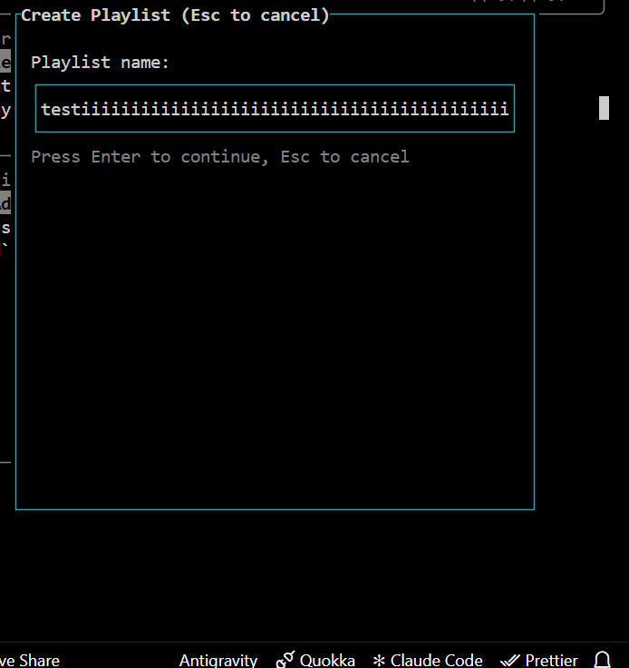
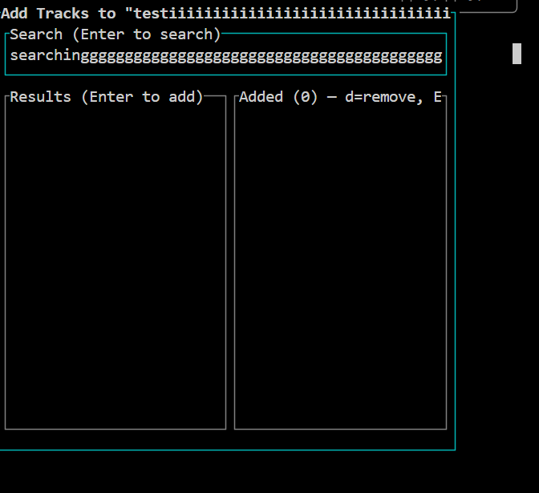
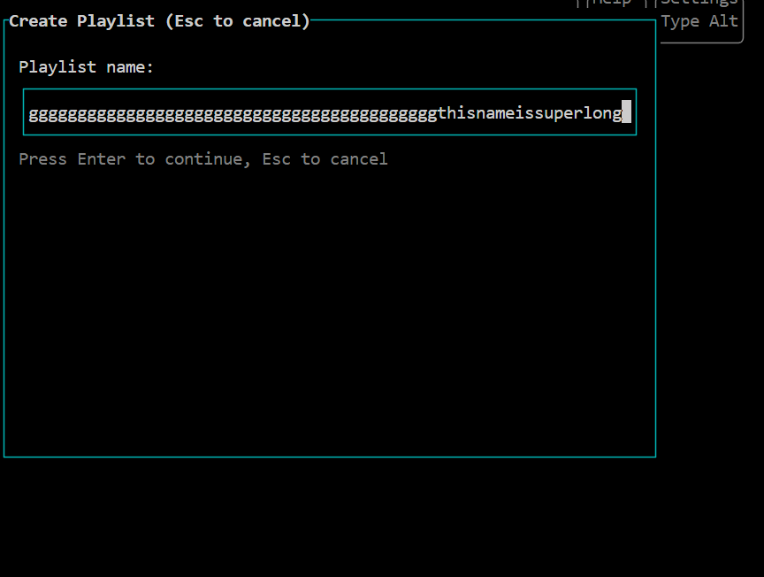
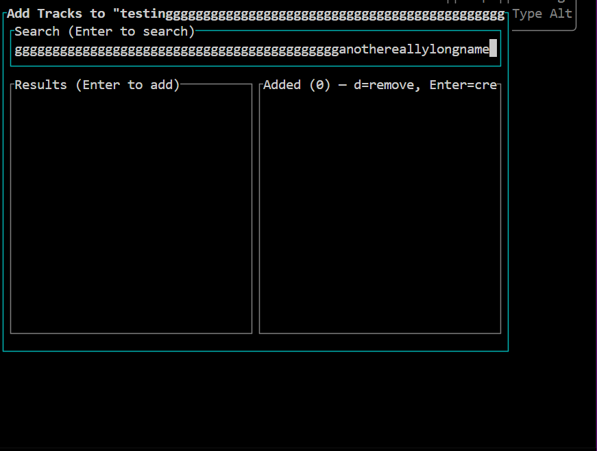

# Fixing input boxes in an open source terminal music player

## Overview

I completed my first open source contribution to spotatui, a music player built for the terminal and written in Rust. While making a playlist, two input boxes (one for the playlist name and one to search for songs to add) cut off long text and let the cursor escape past the right side of the window, so users couldn't see what they were typing. I fixed both boxes so the text scrolls and the cursor stays inside the box. My [PR](https://github.com/LargeModGames/spotatui/pull/964) was approved and merged by the maintainer.

## What happened

To start, I followed the instructions in the contribution doc to run the music player on my Windows 11 machine in a Git Bash terminal. This involved installing Rust, as this was my first time working in a Rust codebase, and installing the app using the provided command `winget install spotatui`. After I had the app running with the repo forked and cloned onto my local machine, I verified the bug through the terminal UI to make sure it was active as described in the issue. The problem gets more noticeable the smaller the terminal is, so I shrank mine to reach it faster. You can see the results below:

**Spotatui cursor overflow on Create Playlist naming**



**Spotatui cursor overflow on Create Playlist search**



After verifying the bug, I followed the issue description, which provided potential areas where the bug may be located. Both bugs were in `src/tui/ui/create_playlist.rs`, in the functions that create the two input boxes: `draw_name_stage` for the playlist name and `draw_add_tracks_stage` for searching for songs to add. Both functions generated a paragraph with no scroll, so the text clipped, and with no clamp on the cursor position, so the cursor could leave the box.

To fix the bug, I followed the implementation of the general search bar of the app, which did not have these bugs. The ticket specifically asked for parity between the two bugged input boxes and the general search box. I first added two tests to the test module of `create_playlist.rs` that check whether the cursor stays inside the box. Both tests failed at first. This was a second check on top of the UI verification, and it let me re-run them later to confirm my fix actually resolved the problem. Both failed the way the issue described:

```bash
test ...long_playlist_name_keeps_the_cursor_inside_the_input_box ... FAILED
cursor escaped the box: x=213
test ...long_search_query_keeps_the_cursor_inside_the_search_box ... FAILED
cursor escaped the box: x=212
test result: FAILED. 0 passed; 2 failed; 0 ignored; 0 measured; 1790 filtered out
```

With the failing tests in place, I implemented the fix for both boxes. I created a helper function, based on the setup for the general search box, that calculates the usable width of the input box and returns how far the text needs to scroll once the cursor reaches the end of the box:

```rust
fn input_scroll(cursor: u16, box_width: u16) -> u16 {
  let inner_width = box_width.saturating_sub(2);
  if inner_width > 0 && cursor >= inner_width {
    cursor - inner_width + 1
  } else {
    0
  }
}
```

Then I passed that offset into each input box with `Paragraph::new(name_text).scroll((0, offset))` and subtracted it from the cursor position, so the cursor stops at the right edge of the box instead of leaving it.

After the fix, I re-ran the `create_playlist` tests. The two render tests that failed before now pass, along with the two new tests for the helper function:

```bash
cargo test --no-default-features --features telemetry,tui create_playlist

running 10 tests
test tui::ui::create_playlist::tests::input_scroll_keeps_the_cursor_inside_the_box ... ok
test tui::ui::create_playlist::tests::input_scroll_is_zero_while_the_cursor_fits ... ok
test tui::ui::create_playlist::tests::long_playlist_name_keeps_the_cursor_inside_the_input_box ... ok
test tui::ui::create_playlist::tests::long_search_query_keeps_the_cursor_inside_the_search_box ... ok
(plus 6 existing create_playlist tests, all ok)

test result: ok. 10 passed; 0 failed; 0 ignored; 0 measured; 1784 filtered out
```

The full suite also passed (1848 tests, 0 failed). I further verified my fix in the UI:

**Spotatui cursor overflow fix on Create Playlist naming**



**Spotatui cursor overflow fix on Create Playlist search**



Before submitting, I ran my `pr-precheck` Claude skill against the PR draft and my plan. It failed on the first run because of its `silent-drift` check: my diff changed `CHANGELOG.md`, but my plan never mentioned it. The repo expects a changelog line for any change users will notice, so I added that step to my plan and it passed on the second run.

I then opened the PR, and the automatic CodeRabbit reviewer suggested an additional fix. It would have made the input box handle consecutive emojis properly, since too many in a row throw off the offset based on how the terminal calculates emoji widths, and the box looks empty even when it has text. After reviewing the suggestion myself, I decided against adding it to my PR and responded with a comment for the maintainer. This is a bug found in all of the input boxes of the terminal UI, and this issue specifically wanted parity between the create playlist boxes and the main search box. Furthermore, the fix would have meant changing the handler, which the ticket also specifically said not to touch.

A couple of days later, the maintainer agreed that this should be a separate issue fixed at the handler level, so it fixes all the input boxes together and keeps the current parity. He also asked me to tighten my tests:

> "Could the two render tests assert the exact cursor x instead of a range? On 100x30 that is 86 for the name box and 87 for the search box, and an off-by-one in the offset would then fail."

My original tests only checked that the cursor was somewhere between the borders, so an off-by-one in the offset would still have passed. For example, the name box test only had range checks like this:

```rust
assert!(cursor.x < 87, "cursor escaped the box: x={}", cursor.x);
assert!(cursor.x > 12, "cursor is on the left border: x={}", cursor.x);
```

I replaced the range checks in both render tests with an exact check on the cursor's x position: 86 for the name box and 87 for the search box. I made sure everything still passed and re-pinged the maintainer with the update. He merged my changes and added me to the contributors section of the README of the repo!

## Limitations and what's next

My fix only brings the two create playlist boxes to parity with the main search bar, so it inherits that bar's limitation: consecutive emojis still throw off the scroll offset and can make the box look empty. The maintainer asked me to track that as a separate issue, but I have not opened it yet. My render tests also only check one terminal size (100x30), so a different layout could still hide a problem.

From here, I would like to keep contributing to the repo on more complex issues that are not outlined as thoroughly as the one I did first. This will give me more experience working with Rust while gaining a stronger understanding of the codebase. My first step would be opening that emoji issue and then working on the fix, which will involve updates to the handler that handles text input.
